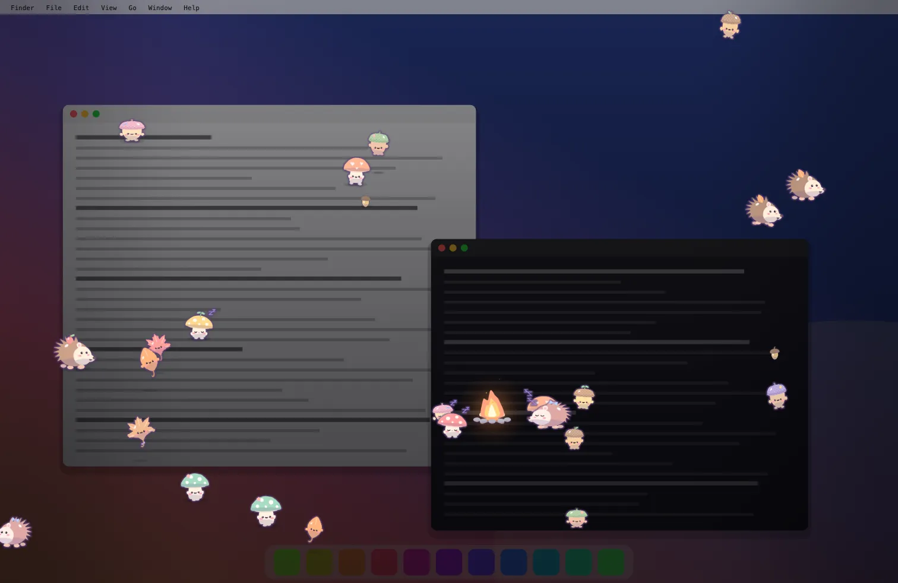
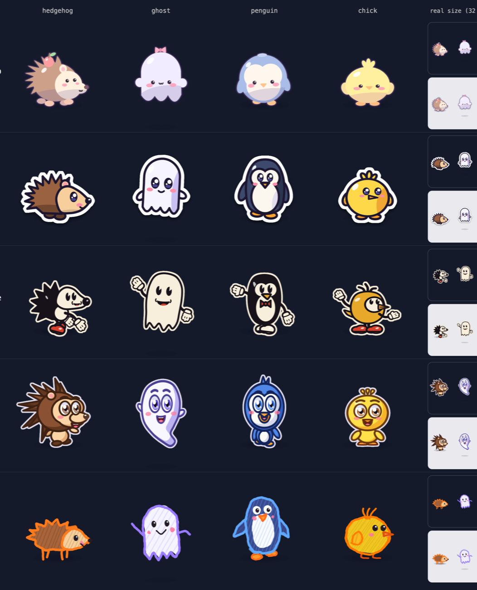

<p align="center"></p>

# Scuttle

A tiny macOS menu bar toy. Lower your MacBook's lid and little seasonal figures sneak onto the screen and get up to things: building a snowman, kicking a ball around, falling asleep by a campfire. Open the lid and you catch them. They freeze, panic, and scramble off the screen.

## Install

```
git clone https://github.com/jensbech/scuttle.git
cd scuttle
make install
```

This builds `Scuttle.app`, copies it to `/Applications` and opens it. `make uninstall` removes it again.

Requires macOS 13 or later and the Swift toolchain (Xcode or the command line tools). The lid trigger needs a MacBook with a lid angle sensor (Apple Silicon, M2 and later). On other Macs the idle trigger and the Preview menu item still work.

## Use

Lower the lid to somewhere between 20 and 40 degrees, wait a few seconds, then open it. The longer the lid stays down, the more figures come out and the more they get done.

Everything else is in the menu bar item: how many figures, the season, the art style (Kawaii, Sticker, Rubber-hose, Mascot, Doodle), the idle trigger, and Preview, which plays the effect without touching the lid.

## Art styles

Every figure is drawn in five styles. Pick one from the menu.

<p align="center"></p>

## Privacy

Scuttle reads the lid angle, the pointer position and the positions of windows, never their titles or contents. The only network use is an optional weather lookup with your location rounded to about 10 km, which decides which guests show up.

## More

- `make test` runs the simulation tests.
- [docs/reference.md](docs/reference.md) has the full reference: seasons, commands, scripts and development notes.
