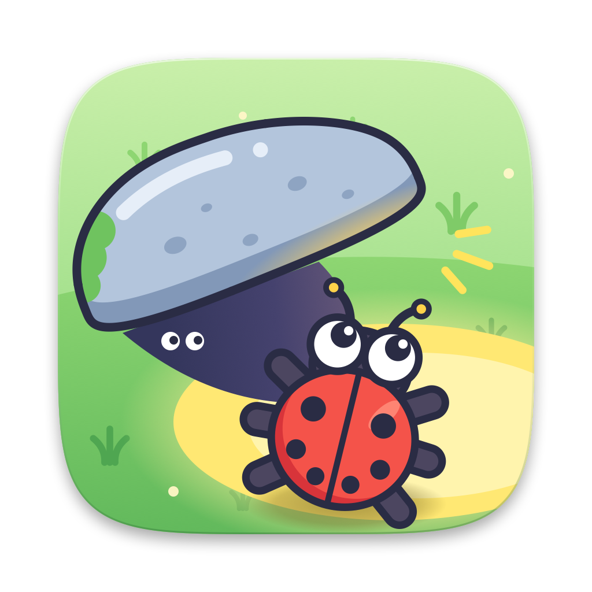

<p align="center"></p>

# Scuttle

Lower your MacBook's lid and the season sneaks onto the screen: butterflies in summer, hedgehogs in autumn, penguins in winter, ghosts at Halloween. Open it again and they all scatter, like bugs when you lift a rock.

Scuttle is a tiny menu bar app. It reads the lid angle sensor built into recent MacBooks and draws on a transparent, click-through overlay, so it never gets in the way of what you're doing.

## Requirements

- macOS 13 or later.
- A MacBook with a lid angle sensor. Apple Silicon models from M2 onwards have one; M1 models reportedly do not. Without a sensor the app still runs and can be driven by the Preview menu item or the scripts below.

## Build and run

```
scripts/build-app.sh          # builds build/Scuttle.app
open build/Scuttle.app
```

Then lower the lid to roughly 20 to 40 degrees, wait for the figures to wander in, and open it.

The menu bar item has: Enabled, how many figures, Season, Art style, Weather, When idle, Spotted (the rare visitor album), Darken screen, Notice windows and pointer, Launch at login, and Preview, which plays the effect without touching the lid.

## Seasons

Who turns up depends on the time of year. Every figure has five colour variants and its own way of moving: crawling, waddling, hopping, fluttering, hovering, drifting or darting.

| Season | When (Automatic) | Who comes out |
|---|---|---|
| Spring | March to May | ladybirds, bumblebees, snails, chicks |
| Summer | June to August | butterflies, dragonflies, fireflies, crabs |
| Autumn | September to November | hedgehogs, acorns, toadstools, drifting leaves |
| Winter | December to February | penguins, snowmen, snowflakes, robins |
| Halloween | 24 to 31 October | ghosts, bats, pumpkins, (friendly) spiders |
| Christmas | 1 to 26 December | gingerbread people, presents, elves, reindeer |
| New Year | 31 December and 1 January | balloons, stars, sparklers, rockets |

Opening the lid quickly catches them in the act. Everyone freezes at the same instant (anything they were carrying drops, sleepers bolt upright), jumps with a big "!", holds stock-still for half a second while a couple of them exchange a look and one tries to act natural, then they wind up and dash for the nearest edge, the ones closest to it first. The whole crowd is gone in about three seconds. Opening the lid slowly lets them tiptoe away instead.

Now and then one figure loses its way when the others scatter, and dithers about for a few seconds before finding the exit.

Pick a season or Automatic from the Season submenu. Automatic shows which season it picked today. Southern hemisphere (guessed from your region) flips spring, summer, autumn and winter; the festive ones stay on their dates.

## Art styles

The figures can be drawn in five styles, picked from the Art style submenu: Kawaii blob (the default), Sticker, Rubber-hose, Mascot and Doodle. The same choice is available as `scuttle://style/<name>`, `scripts/lid style <name>` or `--style <name>`, with the names `kawaii`, `sticker`, `hose`, `mascot` and `doodle`.

## When you're away

You do not have to touch the lid at all. When you have not typed or moved the mouse for a while, the screen dims a little and the figures creep in anyway. The first keypress or mouse move scatters them.

Pick the delay under When idle: Off, 1, 3 (the default) or 10 minutes. Idle dimming is gentler than lowering the lid. It never kicks in while something is keeping the display awake, such as a video playing or a call, and it leaves a held angle or a playing timeline alone. It also works on Macs without a lid sensor, and on an external display when the lid is shut.

## Weather

With Weather set to Live, a few guest figures join the cast to suit the weather outside: a sun on a clear day, clouds when it is grey or foggy, frogs and clouds in the rain or a thunderstorm, a snowflake when it snows, a leaf on a windy day, and an owl at night. The weather only changes who turns up; nothing is drawn over the screen as rain, snow or fog. The menu shows the current reading, for example "Live · Rain".

To get it, Scuttle asks macOS for your approximate location (the system asks you first; say no and weather simply stays unknown). It rounds the coordinates to one decimal place, roughly 10 km, and sends only those to [Open-Meteo](https://open-meteo.com), a free weather service that needs no account:

```
https://api.open-meteo.com/v1/forecast?latitude=51.5&longitude=-0.1&current=weather_code,wind_speed_10m,is_day
```

Nothing else goes with it: no cookies, no identifier, a plain "Scuttle" user agent. It asks at most every 30 minutes, and after the Mac wakes if the last reading is old. The last reading is kept for up to 3 hours. Night comes from the reading, or from the clock (19:00 to 07:00) when there is none.

Set Weather to Off to turn all of this off; then Scuttle never asks for your location or touches the network. You can also pick a fixed kind (Clear, Cloudy, Rain, Snow, Thunderstorm, Fog, Windy) to see which guests it brings.

## Windows and the pointer

With Notice windows and pointer ticked (the default), the figures know a little about what is on your screen while they are out: where the mouse pointer is and how fast it is moving, and where the top edges of your windows and the Dock are, so they can perch on them. A window edge that is covered by another window in front of it does not count, and neither do edges tucked under the menu bar.

Privacy: Scuttle reads only window positions and sizes (plus their layer and transparency, to skip menus and invisible windows), never window titles or what is in them, and it never asks for Screen Recording, Accessibility or Input Monitoring permission. The pointer position comes from the same place the system cursor does. None of it is stored or sent anywhere; nothing leaves the Mac. It is only looked at while figures are out or the screen is dimmed, at most once a second for windows, and not at all otherwise.

Untick it, or use `scuttle://surroundings/off`, `scripts/lid surroundings off` or `--surroundings off`, and the figures ignore windows and the pointer entirely.

## Rare visitors

Once in a while, after the figures have been out in the dark for a bit, a rare visitor joins them: a bunny in spring, a turtle in summer, a fox in autumn, a polar bear in winter, a black cat at Halloween, Santa at Christmas, a comet at New Year, and very occasionally a UFO.

The Spotted submenu is your album: it lists the ones you have seen, how often, and "???" for the rest. The menu bar icon sparkles for a moment when you spot a new one. The album lives in `~/Library/Application Support/Scuttle/album.json` and survives restarts; Reset album… starts it over.

## Try it without touching the lid

```
scripts/demo.sh               # plays the "peek" timeline with a status line, then quits
scripts/demo.sh tease         # other timelines: slow-open, tease, or a path to a JSON file
```

With the app running, `scripts/lid` drives it by hand:

```
scripts/lid angle 25          # hold the lid at 25 degrees
scripts/lid sweep 110 20 3    # move from 110 to 20 degrees over 3 seconds
scripts/lid play peek         # play a timeline
scripts/lid sensor            # back to the real sensor
scripts/lid ambush            # everyone settles in at once, then gets caught by the open lid
scripts/lid sleep stage       # as if the display just went to sleep: stage a full, frozen scene
scripts/lid sleep wake        # as if it just woke: the staged scene gets caught
scripts/lid season winter     # auto, or a season name
scripts/lid hemisphere south  # flip the four seasons for Automatic
scripts/lid idle now          # as if you just walked away; touch anything to scatter them
scripts/lid weather snow      # live, off, or a fixed kind
scripts/lid rare fox          # summon a rare visitor (no name: this season's)
scripts/lid surroundings off  # ignore windows and the pointer
scripts/lid ledge 200 500 400 # a pretend window top from x 200 to 600 at height 500
scripts/lid pointer 300 200   # pin the pointer somewhere; pointer clear lets it go
scripts/lid state             # print the app's current state
scripts/lid quit
```

These go through the `scuttle://` URL scheme, which you can also call from Raycast, Alfred or a shell script:

```
open -g "scuttle://angle/25"
```

Commands: `on`, `off`, `toggle`, `angle/<deg>`, `sensor`, `play/<name>`, `play?file=<path>`, `stop`, `ambush`, `sleep/stage`, `sleep/wake`, `hud/on|off|toggle`, `population/<n>`, `season/<auto|name>`, `hemisphere/northern|southern|toggle`, `idle/now|hold|wake|off|<seconds>`, `weather/live|off|<name>`, `style/<name>`, `night/auto|on|off`, `rare`, `rare/<name>`, `album/reset`, `surroundings/on|off|toggle`, `ledge?x=<x>&y=<y>&w=<width>[&h=<height>]`, `ledge/clear`, `pointer?x=<x>&y=<y>`, `pointer/clear`, `quit`. Season names are `spring`, `summer`, `autumn`, `winter`, `halloween`, `christmas` and `newyear`; the app also takes `--season <auto|name>` on the command line.

`idle/now` acts as if the idle delay just passed; real input or `idle/wake` ends it. `idle/hold` is the same but ignores real input until `idle/wake`, which is handy in scripts. Weather names are `clear`, `cloudy`, `rain`, `snow`, `storm`, `fog` and `wind`, and the app takes `--weather <live|off|name>` too. `night/on` and `night/off` force night for testing; `night/auto` goes back to the reading or the clock. Rare visitor names are `bunny`, `turtle`, `fox`, `polarbear`, `blackcat`, `santa`, `comet` and `ufo`; a summoned one comes out once it is dark.

`ledge` and `pointer` are for trying the window and pointer behaviour without arranging real windows. Coordinates are in points on the overlay's screen with the origin at the bottom left and y going up. A pretend ledge is a window top running from `x` to `x + w` at height `y`, reaching `h` points down (default: to the bottom of the screen); pretend ledges stay until `ledge/clear`. A pinned pointer replaces the real one until `pointer/clear`.

While running, Scuttle writes its state to `~/Library/Application Support/Scuttle/state.json` and removes the file on quit. Besides the lid angle, light level and visible figures it has `weather` (the kind in use, or null), `weatherSetting` (`live`, `off` or a kind), `style`, `night`, `idle` (true during an idle spell), `idleSetting` (the delay in seconds, 0 for off), `spotted` (the rare visitors in the album), `surroundings` (whether Notice windows and pointer is on), `ledges` (how many window tops the figures can see right now), `pointer` (true when the pointer is on the overlay's screen and being noticed), `ledgeScans` (how many times the window list has been read this run), `sleep` (`awake`, `staged` while a frame is held for the wake, or `waking`), `catching` (true while a catch is playing), `wakeCatches` (how many catches started from a wake this run) and `overlayShown` (whether the overlay window is on screen).

`--fresh` ignores saved preferences and the album, saves nothing, and never asks for your location or fetches the weather; `--headless` never fetches the weather either. `--album <file.json>` keeps the album somewhere else, which is what the end-to-end test uses.

### Timelines

A timeline is a JSON list of lid angles over time:

```json
{
  "loop": false,
  "keyframes": [
    { "t": 0, "angle": 110 },
    { "t": 4, "angle": 22, "ease": "inOut" },
    { "t": 12, "angle": 22 },
    { "t": 12.35, "angle": 115, "ease": "inOut" }
  ]
}
```

`ease` is `linear` (default), `inOut` or `hold`. Examples are in `scripts/timelines/`.

## Tests

```
swift test                    # simulation and timeline unit tests
scripts/e2e.sh                # launches the real app and checks it end to end
```

`ScuttleSnap` renders the effect to PNG files, which is handy for checking the art without recording the screen:

```
swift run ScuttleSnap sheet /tmp/autumn.png --season autumn   # every mood, frame and colour of a cast
swift run ScuttleSnap timeline scripts/timelines/peek.json /tmp/peek --season winter
swift run ScuttleSnap seasons /tmp/seasons.png                # one dark panel per season
swift run -c release ScuttleSnap catch /tmp/catch.png --style sticker --season winter   # the catch as a contact sheet
swift run -c release ScuttleSnap bench --season christmas
```

## Releasing

```
scripts/build-app.sh --zip    # dist/Scuttle-<version>.zip, ad-hoc signed
SIGN_IDENTITY="Developer ID Application: ..." NOTARY_PROFILE=<profile> scripts/build-app.sh
```

The version comes from the `VERSION` file. An ad-hoc signed build runs on your own Mac; other people will need a Developer ID signed and notarized build to open it without a Gatekeeper warning.

`scripts/make-assets.sh` regenerates the app icon and menu bar icon from code.

## How it is put together

| Folder | What it holds |
|---|---|
| `Sources/ScuttleCore` | The simulation: light from lid angle, the seasonal casts and how they move, tuning, timelines. No UI. |
| `Sources/ScuttleRender` | Core Graphics drawing of the figures (`Styles/`, one folder per art style) and the darkness. |
| `Sources/Scuttle` | The app: lid sensor, overlay window, menu, URL scheme, state file. |
| `Sources/ScuttleSnap` | Offscreen snapshot and benchmark tool. |

Most of the feel lives in `Sources/ScuttleCore/Tuning.swift`.

The lid angle sensor is not a public macOS API. Scuttle reads it the same way other lid-angle apps do, and a future macOS release could change it.

## Closing the lid all the way

A MacBook normally sleeps when the lid shuts, so nothing can be drawn while it is closed. Scuttle sets the scene on the way down instead: as the lid closes, or the display goes to sleep, it lets the whole crowd come out and get busy, draws that frame and leaves it on screen while the display is off. When you open the lid the figures are already there, frozen mid-activity, and the catch starts from the moment the display wakes, with a slightly longer hold so you have time to see them. Darken screen, if it is on, is already in place and lifts as they scatter.

This only happens on the built-in display while Scuttle is enabled. With the lid shut and an external display in use nothing is staged on the screen that stays lit. If the Mac locks, the scene stays hidden behind the lock screen and plays once you unlock; switching users cancels it. You do not need to change any sleep settings.
